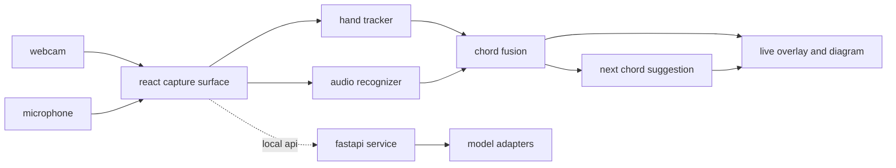
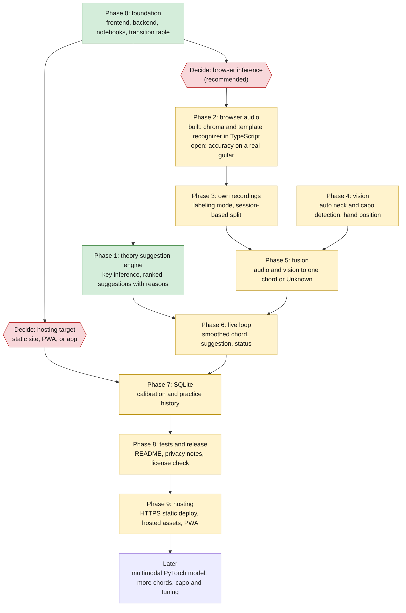

# FretFly

A free, local-first guitar practice assistant that combines webcam hand tracking, microphone audio, and chord progression guidance.

## Current status

The repository currently contains the first runnable foundation:

- React and TypeScript frontend with a live camera permission flow.
- A generated chord library in `frontend/src/theory/voicings.ts`: playable fingerings for every root and 13 qualities (major, minor, 7th, maj7, m7, dim, aug, sus, and more) in standard tuning, ranked by ease, with up to four alternatives each.
- Data-driven fretboard diagrams that show barres and a fret number for shapes up the neck.
- A manual capo control (on/off and fret). Chords are tracked by sounding pitch, and suggestions show which shape to play.
- MediaPipe hand-landmark integration with a local model asset boundary.
- FastAPI local health and demo prediction endpoints.
- A theory suggestion engine in `frontend/src/theory`: it infers the likely key from the chords played so far and suggests ranked next chords, each with a reason. It works in every key and keeps the running progression.
- Copilot project context in [COPILOT_CONTEXT.md](COPILOT_CONTEXT.md).

- Browser chord recognition in `frontend/src/audio`: the microphone is analyzed about ten times a second, chroma is matched to a template for every chord in the library, and a chord that holds steady is added to the progression. Weak evidence shows `Unknown`. The mic is opened with echo cancellation, noise suppression, and auto gain off, since they distort guitar.

Recognition has only been tested on synthetic audio, so treat its accuracy on a real guitar as unmeasured. Tapping a shape or a suggestion still works as a manual fallback. There is no vision-based chord detection yet.

## Architecture

The project is intentionally split into a browser experience and a local Python service. The browser owns media permissions and the interactive overlay. The backend owns stable inference contracts so model implementations can change without forcing a UI rewrite.



### Frontend

The React application in `frontend/src` currently provides:

- camera and microphone permission handling through `getUserMedia`
- a mirrored video surface and overlay layer
- a small, typed chord vocabulary
- data-driven chord diagrams
- confidence, signal status, and next-chord presentation

The current readout is deliberately a demo baseline. The UI should consume prediction contracts rather than know how a model produces them.

### Backend

The FastAPI application in `backend/app` currently exposes:

- `GET /health`, which verifies that the local service is available
- `GET /api/demo-chord`, which returns a typed demo prediction

Future model adapters should fit behind these boundaries:

- `HandTracker`: camera frames to landmarks and neck-position confidence
- `AudioChordRecognizer`: audio windows to chord probabilities
- `ChordFusion`: visual and audio evidence to one prediction
- `SuggestionEngine`: current chord to a constrained next chord

### Data and privacy

Camera and microphone streams are requested by the browser and are not uploaded by the current implementation. Future SQLite storage is intended for local calibration and practice history only. Raw media, credentials, generated datasets, and model weights must remain outside version control.

### Current limitations

- hand landmarks require the local `hand_landmarker.task` asset described below
- the camera shows separate manual fretboard and strumming guides; automatic guitar geometry detection is not implemented yet
- audio recognition is new and has only been tested on synthetic guitar-like sound. Real accuracy is unmeasured and will depend on the microphone, the room, and the guitar
- chords made of the same notes (C6 and Am7, for example) rely on the bass note, and seventh and sixth shapes often fall back to the plain triad when the extra note is quiet
- the recognizer assumes standard tuning and one guitar; strummed chords work best, single notes and fast changes are not handled yet
- the audio and vision models only target `C`, `G`, `Am`, and `F`; the suggestion engine and chord library already cover every root and quality
- generated shapes are root-position, standard tuning, and ranked by a simple difficulty score, not by player testing; inversions and slash chords are not generated yet
- the capo is set by hand; automatic capo and neck detection is not implemented
- the application does not yet account for alternate tunings, handedness, or guitar variation

## Run the frontend

```powershell
cd frontend
npm install
npm run dev
```

## Run the backend

```powershell
python -m venv .venv
.\.venv\Scripts\Activate.ps1
pip install -r backend\requirements.txt
python -m uvicorn backend.app.main:app --reload
```

The API health endpoint is available at `http://127.0.0.1:8000/health`.

## Run the training notebooks

```powershell
python -m venv .venv
.\.venv\Scripts\Activate.ps1
pip install torch --index-url https://download.pytorch.org/whl/cpu
pip install -r training\requirements.txt
jupyter notebook training\notebooks
```

`chord_audio_pytorch_baseline.ipynb` trains a small PyTorch CNN on chroma features from synthetic chord audio. It saves its weights to `models/chord_cnn_chroma.pt`, which git ignores. It is a pipeline check, not a real guitar recognizer.

`guitarset_chroma_finetune.ipynb` loads real GuitarSet recordings and fine-tunes the same model. Labels come from `training/prepare_guitarset.py`, which reads the GuitarSet annotations in `data/raw/guitarset`. Keep the downloaded zips and extracted audio there. Git ignores that folder.

## Chord transitions

`training/build_transition_table.py` counts which chords follow which in the GuitarSet verified annotations. It writes `backend/app/data/chord_transitions.json`, which the suggestion engine will load. The table is derived counts only, with no audio. Am has no transitions inside the app's vocabulary, because every Am segment in the data is followed by a chord outside it.

## Enable hand tracking

The frontend uses MediaPipe Tasks Vision in the browser. Download the free `hand_landmarker.task` model from the official MediaPipe model release and place it at `frontend/public/models/hand_landmarker.task`. The model directory is ignored by Git so model weights are not committed.

The WASM runtime is loaded from jsDelivr during development. Hand landmarks are drawn on a canvas over the mirrored camera feed. If the model is missing, camera capture still works and the application stays in manual mode.

The camera panel displays the live `getUserMedia` video underneath the landmark overlay. It separates the expected fretboard/fretting region from the strumming region. Use `calibrate guitar` after arranging the instrument in the frame to mark the current geometry as ready for the next detector. Use the `camera upright` / `camera inverted` control when the webcam or phone is mounted upside down. These are user-selected calibrations because a webcam stream does not reliably expose its physical mounting angle or guitar geometry on its own.

See [COPILOT_CONTEXT.md](COPILOT_CONTEXT.md) for architecture boundaries, privacy rules, and implementation guidance.

## Hosting goals

The intent is to publish FretFly as a public website, and possibly an installable app later. Work done now should keep that cheap and private:

- **Core features run in the browser.** Audio, hand tracking, fusion, and suggestions should work with no server, so the site can be static hosting. The FastAPI service stays optional, for development and offline experiments.
- **Camera and microphone need HTTPS.** Browsers only allow `getUserMedia` on `localhost` or secure origins, so any host must serve HTTPS.
- **Model files must be hosted.** `hand_landmarker.task` and the exported audio model are gitignored, so the deploy step must fetch or upload them. Prefer self-hosting the MediaPipe WASM files over a CDN once the version is pinned.
- **User data stays on the device.** In a hosted version, calibration and practice history belong in browser storage (IndexedDB or localStorage), not a server SQLite file, so no media or personal data is collected.
- **Check licenses before publishing.** Confirm the GuitarSet license terms, and the licenses of MediaPipe and any other model, before shipping anything trained on or derived from them.

## Roadmap

Green boxes are done, yellow are next, and red are decisions that block a phase. Arrows show what each phase needs first.



| Phase | Goal | Done when |
|---|---|---|
| 0. Foundation | App shell, backend, training pipeline, transition table | Complete |
| 1. Theory suggestion engine | Ranked next-chord suggestions with a reason each, from key inference and harmonic function, in any key, updating as the progression grows. Runs in the browser with no stored progressions | Complete: `frontend/src/theory`, covered by `npm test` in `frontend` |
| 2. Browser audio | Mic audio becomes chroma in the browser and is matched to a template for every chord in the library, with the bass note separating chords that share notes | Built, and the app shows a chord with confidence or `Unknown`. Tested on synthetic audio only. Still open: measured accuracy on real guitar recordings, and whether the trained model adds anything over templates |
| 3. Own recordings | Record and label your own clips for the app's setup | The model is validated on a separate recording session and the confusion matrix is reported |
| 4. Vision | Find the guitar neck and any capo automatically, with no manual calibration, and track hand position along the neck. Needs a trained detector and labeled images | Neck and capo fret are detected on held-out photos and video, with measured accuracy, and hand position maps to a fret region |
| 5. Fusion | Combine audio and vision into one result, using visual cues (fret region, shape, capo) to separate chords that sound alike | Compared audio-only, vision-only, and fused accuracy on recorded sessions, including the confusable pairs |
| 6. Live loop | Smooth the chord estimate and update suggestions live | The chord doesn't flicker, and the status panel shows the real state |
| 7. Persistence | Move calibration and practice history to SQLite | Calibration survives a reload, and sessions are stored locally |
| 8. Release | Tests, docs, privacy notes, and the license check | Tests pass on a clean install, and the repo is ready to share |
| 9. Hosting | Public site (and optionally an installable app) anyone can open | The production build loads over HTTPS, camera and mic work, hand model and exported audio model load from hosted assets, and no backend is required for core features |
| Later | Multimodal model, more chords, capo and tuning | Each item has its own evaluation before it is claimed |
