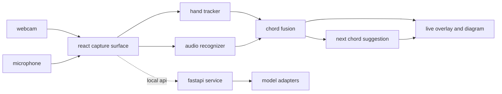
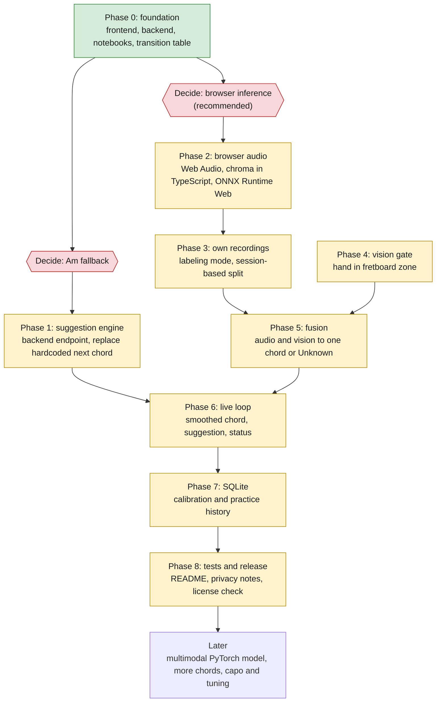

# FretFly

A free, local-first guitar practice assistant that combines webcam hand tracking, microphone audio, and chord progression guidance.

## Current status

The repository currently contains the first runnable foundation:

- React and TypeScript frontend with a live camera permission flow.
- Manual chord-shape library for `C`, `G`, `Am`, and `F`.
- Data-driven fretboard diagram rendering.
- MediaPipe hand-landmark integration with a local model asset boundary.
- FastAPI local health and demo prediction endpoints.
- Copilot project context in [COPILOT_CONTEXT.md](COPILOT_CONTEXT.md).

The current chord prediction is a deterministic demo baseline. It is not yet a trained audio or vision model.

## Architecture

The project is intentionally split into a browser experience and a local Python service. The browser owns media permissions and the interactive overlay. The backend owns stable inference contracts so model implementations can change without forcing a UI rewrite.



### Frontend

The React application in `frontend/src` currently provides:

- camera and microphone permission handling through `getUserMedia`
- a mirrored video surface and overlay layer
- a small, typed chord vocabulary
- data-driven chord diagrams
- confidence, signal status, and next-chord presentation

The current readout is deliberately a demo baseline. The UI should consume prediction contracts rather than know how a model produces them.

### Backend

The FastAPI application in `backend/app` currently exposes:

- `GET /health`, which verifies that the local service is available
- `GET /api/demo-chord`, which returns a typed demo prediction

Future model adapters should fit behind these boundaries:

- `HandTracker`: camera frames to landmarks and neck-position confidence
- `AudioChordRecognizer`: audio windows to chord probabilities
- `ChordFusion`: visual and audio evidence to one prediction
- `SuggestionEngine`: current chord to a constrained next chord

### Data and privacy

Camera and microphone streams are requested by the browser and are not uploaded by the current implementation. Future SQLite storage is intended for local calibration and practice history only. Raw media, credentials, generated datasets, and model weights must remain outside version control.

### Current limitations

- hand landmarks require the local `hand_landmarker.task` asset described below
- the camera shows separate manual fretboard and strumming guides; automatic guitar geometry detection is not implemented yet
- audio is not yet analyzed; the microphone status is currently informational
- chord confidence is a fixed demo value
- the vocabulary only covers `C`, `G`, `Am`, and `F`
- the application does not yet account for tuning, capo, handedness, or guitar variation

## Run the frontend

```powershell
cd frontend
npm install
npm run dev
```

## Run the backend

```powershell
python -m venv .venv
.\.venv\Scripts\Activate.ps1
pip install -r backend\requirements.txt
python -m uvicorn backend.app.main:app --reload
```

The API health endpoint is available at `http://127.0.0.1:8000/health`.

## Run the training notebooks

```powershell
python -m venv .venv
.\.venv\Scripts\Activate.ps1
pip install torch --index-url https://download.pytorch.org/whl/cpu
pip install -r training\requirements.txt
jupyter notebook training\notebooks
```

`chord_audio_pytorch_baseline.ipynb` trains a small PyTorch CNN on chroma features from synthetic chord audio. It saves its weights to `models/chord_cnn_chroma.pt`, which git ignores. It is a pipeline check, not a real guitar recognizer.

`guitarset_chroma_finetune.ipynb` loads real GuitarSet recordings and fine-tunes the same model. Labels come from `training/prepare_guitarset.py`, which reads the GuitarSet annotations in `data/raw/guitarset`. Keep the downloaded zips and extracted audio there. Git ignores that folder.

## Chord transitions

`training/build_transition_table.py` counts which chords follow which in the GuitarSet verified annotations. It writes `backend/app/data/chord_transitions.json`, which the suggestion engine will load. The table is derived counts only, with no audio. Am has no transitions inside the app's vocabulary, because every Am segment in the data is followed by a chord outside it.

## Enable hand tracking

The frontend uses MediaPipe Tasks Vision in the browser. Download the free `hand_landmarker.task` model from the official MediaPipe model release and place it at `frontend/public/models/hand_landmarker.task`. The model directory is ignored by Git so model weights are not committed.

The WASM runtime is loaded from jsDelivr during development. Hand landmarks are drawn on a canvas over the mirrored camera feed. If the model is missing, camera capture still works and the application stays in manual mode.

The camera panel displays the live `getUserMedia` video underneath the landmark overlay. It separates the expected fretboard/fretting region from the strumming region. Use `calibrate guitar` after arranging the instrument in the frame to mark the current geometry as ready for the next detector. Use the `camera upright` / `camera inverted` control when the webcam or phone is mounted upside down. These are user-selected calibrations because a webcam stream does not reliably expose its physical mounting angle or guitar geometry on its own.

See [COPILOT_CONTEXT.md](COPILOT_CONTEXT.md) for architecture boundaries, privacy rules, and implementation guidance.

## Roadmap

Green boxes are done, yellow are next, and red are decisions that block a phase. Arrows show what each phase needs first.



| Phase | Goal | Done when |
|---|---|---|
| 0. Foundation | App shell, backend, training pipeline, transition table | Complete |
| 1. Suggestion engine | Backend returns the likely next chord from the transition table | Each vocabulary chord returns a valid suggestion, and the frontend uses the endpoint |
| 2. Browser audio | Mic audio becomes chroma in the browser and runs the exported model | Browser and Python chroma match on saved clips, and the app shows a chord with confidence or `Unknown` |
| 3. Own recordings | Record and label your own clips for the app's setup | The model is validated on a separate recording session and the confusion matrix is reported |
| 4. Vision gate | Use hand position in the fretboard zone as evidence | Measured effect on wrong audio guesses, with the gate on and off |
| 5. Fusion | Combine audio and vision into one result | Compared audio-only, vision-only, and fused accuracy on recorded sessions |
| 6. Live loop | Smooth the chord estimate and update suggestions live | The chord doesn't flicker, and the status panel shows the real state |
| 7. Persistence | Move calibration and practice history to SQLite | Calibration survives a reload, and sessions are stored locally |
| 8. Release | Tests, docs, privacy notes, and the license check | Tests pass on a clean install, and the repo is ready to share |
| Later | Multimodal model, more chords, capo and tuning | Each item has its own evaluation before it is claimed |
